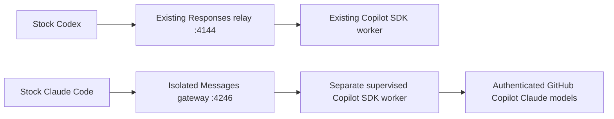

# Stock Claude Code through Copilot — isolated preview

Adapter **0.1.13**, source candidate **1.3.59**. The preceding 1.3.54 candidate passed the
finite seven-case Windows regression with stock Claude Code **2.1.292** and
Copilot SDK **1.0.11** on October 7, 2026: 15 completed requests, zero failures,
and **25.691905 reported SDK AI credits**, with actual Opus 5.5, Sonnet 5.5 and
Haiku 4.5 usage. This does not certify every feature, active outages or sustained
load. The preceding increments add settings-routing checks, mixed continuations,
context admission, cache refresh and trailing-system fixes. This is a local review candidate,
not a published release or a claim of full Anthropic parity. The existing Codex
server and dashboard are not replaced. Nothing patches either client binary.



The new portable [single CLI front door](PORTABLE-LAUNCH.md) selects Codex or Claude without editing saved configuration or replacing the live desktop relay.

The integration is opt-in. Launching plain `claude` does not magically select
this gateway. The wrapper routes only its child process; Codex routing remains
under the existing Start/Stop scripts. There is no 9Router, silent provider
fallback, shared-token pool, or direct Anthropic/OpenAI inference adapter here.

## Setup on another developer's machine

1. Install Node.js **22 or later**, Git, and the official clients. Git for Windows
   is recommended for Claude's Bash tool. Follow the
   [Copilot CLI installation guide](https://docs.github.com/en/copilot/how-tos/copilot-cli/set-up-copilot-cli/install-copilot-cli)
   and [Claude Code quickstart](https://code.claude.com/docs/en/quickstart).
   On Windows, the documented installers include:

   ```powershell
   winget install GitHub.Copilot
   winget install Anthropic.ClaudeCode
   copilot --version
   claude --version
   ```

2. Authenticate your own eligible Copilot account with `copilot login`.
   Complete GitHub's browser/device authorization yourself. See the official
   [authentication guide](https://docs.github.com/en/copilot/how-tos/copilot-cli/set-up-copilot-cli/authenticate-copilot-cli).
   Organization policy and model availability still apply. The SDK uses the
   signed-in account; it does not copy its OAuth credentials into this project.

3. Obtain a checkout/source archive **containing `claude-gateway/`**. This
   preview is not yet on public `main`; cloning the older published release is
   not sufficient. In a fresh checkout, run:

   ```powershell
   npm ci
   npm test
   npm audit --omit=dev
   ```

   The candidate pins `sharp` **0.35.5**. Do not install dependencies over an
   active Codex relay. Use a separate checkout instead. The launcher refuses
   vulnerable/unknown sharp versions before starting its SDK worker.

4. Open a terminal in the project you want Claude to work on, then invoke the
   wrapper by its path. For example, if the checkout is `C:\relay`:

   ```powershell
   & 'C:\relay\Start-Claude-With-Copilot.ps1'
   ```

   For a one-shot request or explicit model:

   ```powershell
   & 'C:\relay\Start-Claude-With-Copilot.ps1' -ClaudeArguments @(
     '--model', 'claude-opus-5-5', '-p', 'Explain this repository without editing it.'
   )
   ```

   The cross-platform Node entry point is:

   ```sh
   node /path/to/relay/claude-gateway/launch.mjs --port 4246 -- --model claude-opus-5-5
   ```

5. Inside Claude, check `/status` for the localhost base URL and gateway
   credential variable, then `/model`. The wrapper supplies an exact
   SDK-advertised, non-disabled Claude lineup with labels marked **Copilot**.
   Discovery, generated settings and the actual interactive `/model` menu passed.
   The stock Default option remains alongside the entitled gateway options.
   No `behavesAs` identity spoofing is
   used. The account advertised Opus 5.5, Sonnet 5.5, Haiku 4.5 and older versions
   during testing; your catalog may differ.

6. The wrapper prints a **separate read-only connection-center URL** on an
   available loopback port. It displays Codex routing/status alongside the
   wrapper's isolated Claude gateway. On Windows, add `-OpenSetup` to open it;
   use `-SetupPort 4247` for a fixed observer port or `-NoSetup` to omit it.
   Node launchers accept `--open-setup`, `--setup-port 4247`, and `--no-setup`
   before `--`. A fixed-port conflict reports observer unavailability without
   altering inference routing. No settings, tokens or logins are copied.

   ```powershell
   & 'C:\relay\Start-Claude-With-Copilot.ps1' -OpenSetup
   ```

   ```sh
   node /path/to/relay/claude-gateway/launch.mjs --open-setup -- --model claude-opus-5-5
   ```

   The launcher observes only **its own in-process gateway**. Standalone
   `npm run setup` can detect a Claude installation but does not claim to see
   another wrapper's live traffic. The original Codex 4144 dashboard and history
   are not replaced, migrated or merged by this preview.

The wrapper defaults to manual permissions, preserves supplied permission
rules/modes and managed policies, and does not enable `bypassPermissions`.
Pre-release opt-ins and nonessential client traffic are disabled by default.
Stock Claude still sends baseline versioned protocol controls; those are retained
alongside SDK-owned beta controls, with upstream validation. This is not a promise
that every beta body/block type is implemented. Safe `--settings` JSON/file content is retained except
the model-picker lineup, which is supplied by the gateway. Conflicting routing,
credential-helper, model-override or fallback settings now refuse startup instead
of being ignored or silently removed. See [startup routing checks](CLAUDE-GATEWAY-ROUTING.md).

## What was verified

| Capability | Evidence / status |
|---|---|
| Opus 5.5 inference | Real stock-client reply and SDK usage receipt |
| File Read → Write → Read | Actual `SUM=42` file round trip |
| Stdio MCP | Actual echo result from a deterministic fixture server |
| Parallel mixed-model agents | Sonnet 5.5 and Haiku 4.5 both returned their own proof markers |
| Adaptive effort / fixed thinking | Opus/Sonnet effort and Haiku's fixed budget worked live |
| Auto-mode agent classification | Real stock safety-classifier requests and both worker completions passed after fixing stop sequences |
| Native stop metadata | Exact stop reason/sequence retained; split UTF-8, CRLF, truncation and Copilot transport sentinel tested |
| Image reading | Stock Read tool correctly identified orange/cyan fixture pixels |
| Project skills, CLAUDE.md, hooks | Skill/context markers and actual hook-created file verified |
| Saved client session resume | New Claude process recalled a previous fixture value |
| Picker catalog | Actual interactive stock `/model`: Opus 5.5, Sonnet 5.5, Haiku 4.5 and older entitled versions labelled Copilot |
| Signed thinking | Actual Haiku 4.5 Read/Write/Read round trip; client and upstream block fingerprints identical; 4 completed requests, zero failures |
| Redacted thinking | Exact opaque data, block ordering and replay validated in fixtures; no claim of a live safety-redaction event |
| SDK request translation | Native role/content prefixes retained across tool turns, not replaced with the flattened SDK bootstrap |
| Mixed client-tool input | Results-first user text/image suffix retained; streaming/nonstreaming fixtures, native SDK request-hook proof and rejected-continuation recovery |
| Trailing stock system messages | Stock Linux/Windows Read/Write/Read with scripted loopback transport; exact native suffix retained, context/ownership/prefix guards still enforced |
| Continuation context admission | Estimated full native text plus requested output checked before pending-result delivery; oversized input rejected without losing the valid retry |
| Cache marker movement | Current client cache markers refreshed without accumulating old markers; signed content/tool arguments unchanged |
| Tool catalog cache updates | Current validated markers move/remove across owned continuations; three-turn local native-hook proof and rejected-update/other-owner isolation, not a cache-hit or billing guarantee |
| Compaction | Real stock `/compact` request through Copilot, then fresh process recalled the pre-compaction fixture value |
| Worker/gateway recovery | Owned idle SDK worker stopped/recovered, then entire isolated gateway restarted; saved client context and ledger survived |
| Exact tool controls | Live Opus 5 specific/required choices and strict 128-character client tool; Opus 5.5 serial tools and `none` with catalog retained |
| Native structured outputs | Opus 5.5 streamed `output_config.format` produced schema-matching JSON; exact schema hash retained upstream |
| Native failure fidelity | Before/after fixtures preserve HTTP status/type/retry hint/correlation; native SSE error is a failure terminal, never a completed stream |
| Versioned protocol headers | Baseline stock Claude control headers forwarded alongside SDK flags, without changing SDK authentication |
| Isolation/cancellation/storage | Automated ownership, timeout, abort, restart and retention tests |

Current Windows verification passes **349 repository tests**, including **61 Claude adapter
tests**, **9 visibility/setup tests**, **7 runtime-ownership tests** and **12 routing-settings tests**. Lifecycle/Remote fixture tests passed;
they are not a phone round trip.
Candidate 1.3.54 adds [portable read-only Codex diagnostics](PORTABLE-SETUP-DIAGNOSTICS.md)
without changing the Claude adapter or replacing the Windows lifecycle controls.
Fresh Ubuntu verification passes 347 tests with two Windows-only skips and a
clean dependency audit. The actual stock Linux Codex 0.147.0 diagnostic passed,
but the Linux SDK authentication check reports **not signed in**. No Windows
credentials were copied; real Linux Copilot inference remains unverified.
Live proofs are private under ignored `runtime/claude-live-proof-*` directories
and equivalent directories in the verified checkout. Do not publish those
directories: stock client transcripts, test paths and reports are not release
assets. Paid probes require explicit `--live` and use temporary fixture projects.

```sh
node claude-gateway/probe.mjs --live --case=all
```

Other verified cases: `files`, `structured`, `thinking`, `recovery`, `mcp`, `agents`, `images`, `skills`, `resume`, `local`.
`outage` is an unfinished fault-injection experiment, not an acceptance proof.
Two attempts did not reach the text-frame trigger because the fixture response
contained signed thinking without text. The probe failed its injection assertion;
it did not falsely report recovery. No physical network outage has been tested.
`thinking` requires actual signed blocks in a stock Haiku tool loop and rejects
success-with-retries. `recovery` stops only its own idle SDK worker/gateway;
it does not simulate a network outage or kill the live Codex process.
`auto` tests the real Auto-mode classifier with parallel fixture agents. It passed
on October 7; that is not certification of every permission decision or policy.

## Compatibility limits and release gates

- **Auto-mode agent classification now passed live.** Earlier failures were
  adapter rejections of the classifier's custom stop sequences, not proof that
  Copilot's model was unavailable. Native termination metadata is now preserved.
  Manual permissions remain the preview default; explicitly selecting Auto keeps
  stock Claude's classifier active. Do not weaken approvals or infer universal
  policy parity from a successful fixture test.
- Actual native thinking/signatures and redacted data are forwarded, never
  synthesized. Signed Haiku tool continuations passed live; redactions remain
  fixture-tested. The retained native prefix restores the transport's default
  direct caller when stock Claude omits it; changed signatures/arguments still
  fail. This follows the [thinking preservation rules](https://platform.claude.com/docs/en/build-with-claude/thinking#preserving-thinking-blocks).
  Binding-control betas and every signed restart/model combination remain
  unverified. A signed transcript requiring image repacking is explicitly
  rejected rather than rewriting the prefix silently.
- Hosted server tools/advisor and context-management/experimental betas remain
  unsupported at the body/block semantic layer. Native versioned control headers
  are forwarded and upstream-validated; malformed lists reject before inference,
  and changed flags are bound to continuation ownership. Native tool controls and capability-gated structured outputs are
  implemented; see the exact restrictions below. Custom stop sequences are
  supported with actual upstream stop metadata. Temperature/top-p/top-k are
  validated and forwarded through the native SDK hook.
- Cache annotations on native blocks/system/tools are retained and refreshed
  from the current client request on continuations. Packed-image cache placement
  may differ. Adapter 0.1.11 fixes previously stale tool-definition annotations;
  see [the cache refresh contract](CLAUDE-GATEWAY-CACHE.md). This is not a guarantee
  of identical caching, cache hits, savings or billed token usage.
- `/v1/messages/count_tokens` returns an explicit 501, not a fabricated exact
  count. Local admission uses estimated tokens; oversized prompts fail explicitly
  rather than silently losing history. Stock `/compact` and saved-context recall
  passed live. Long-duration and active network-outage/retry behavior still need
  acceptance testing; idle worker recovery is not that proof.
- Image batches are bounded and may become a labelled overview. That is not
  exact native multi-image parity. URL/file image fetching is deliberately absent.
- Claude Remote Control, cloud sessions and voice dictation are not available
  under this gateway configuration. This is a documented
  [third-party gateway limitation](https://code.claude.com/docs/en/llm-gateway-connect#slack-cloud-sessions-and-remote-control),
  not something solved by exposing a local port or patching Claude.
- Other client versions, macOS/Linux, managed corporate deployments, every
  slash command and a twelve-hour workload are not live-certified.
- The isolated launcher's connection center now displays both clients' status
  and the in-process Claude ledger projection. The existing 4144 dashboard does
  not aggregate the isolated ledger. Merging its history and a unified installer
  remain future work; the connection center is guided/read-only, not an installer.

## Tool controls and structured outputs

`auto`, `none`, and boolean `disable_parallel_tool_use` are forwarded exactly.
`none` keeps the native tool catalog but disables SDK execution. Specific tool
names map to the SDK-owned names, including deterministic short aliases for
128-character client names. Original names are returned to the client.
The gateway fails closed on tools emitted against `none`, a wrong specific
tool, or more than one tool with parallel use disabled. It does not synthesize
tools to fulfill a forced choice.

`any`/`tool` are supported only where the upstream model/settings permit them.
Opus 5.5 and Sonnet 5.5 reject them regardless of thinking settings; manual
`thinking: enabled` also disallows them. Opus 5 forced selection with adaptive
thinking passed live. No model is silently substituted. See the official
[forced-tool restrictions](https://platform.claude.com/docs/en/agents-and-tools/tool-use/implement-tool-use#forcing-tool-use).

`output_config.format: {type: "json_schema", schema: ...}` and `strict: true`
client tools require `structured_outputs: true` in the authenticated SDK catalog.
Haiku did not advertise it in the tested Copilot account, even though the direct
Claude API documents broader support. Copilot's catalog is the admission gate.
Schemas go unchanged to native grammar validation: no local schema rewriting,
additional-property stripping, JSON repair, separate validator or free-form
prompt emulation. The relay checks format shape and the 20-strict-tool limit;
the native provider owns schema dialect, optional/union budgets and compilation
validation. Current documented limits include 24 optional and 16 union
parameters across strict/output schemas. See
[schema support and limits](https://platform.claude.com/docs/en/build-with-claude/structured-outputs#json-schema-limitations).

Refusals and `max_tokens` termination retain their original text and stop reason,
even when the result is not schema-valid. These paths passed streaming and
nonstreaming fixtures; no claim of a live safety refusal is made. Upstream HTTP
failure status, bounded message, type, retry hint and request correlation now
survive SDK error wrapping. Streaming headers wait for actual output or a
heartbeat: early errors retain HTTP status; after the stream starts, errors are
native SSE failures without a fake `message_stop`. Error bodies are bounded to
64 KiB / 2.5 seconds and never retained in the ledger. Native SSE errors are
failure terminals, not truncation/success. Actual transport attempts and SDK
usage remain separate; unreported failed-attempt usage is unknown, not free.

Finite control acceptance:

```sh
node claude-gateway/probe-controls.mjs --live
node claude-gateway/probe.mjs --live --case=structured
```

The control probe passed six actual SDK usage receipts totaling **2.0392 reported
AI credits**, plus three intentional admission rejections with no inference.
Stock `--json-schema` returned the exact parsed fixture object, but Claude
2.1.292 did not request a native format or strict tool for that case. This is a
stock parsed-output proof, not evidence of native grammar constraints. The
separate streamed-format and strict-tool probes provide native-control proof.
All figures are SDK-reported usage, not bills or remaining entitlement.

The later full stock-client regression `claude-live-proof-hmDFJ9` passed file
tools, MCP, images, skills/hooks, saved-session resume and mixed-model agents:
17 usage receipts and **25.16756 reported AI credits**. It ran on adapter 0.1.3,
before the error/header continuation. The subsequent adapter 0.1.4 full regression
`claude-live-proof-cPRAhu` passed all seven stock-client cases, including both
mixed-model workers, with 15 receipts / **24.29012 reported AI credits**. Adapter
0.1.5 adds request accounting fixes with fixture evidence; that result is not
full real-client certification of 0.1.5 or the later candidates. Active-outage/soak proof also remains.

The fresh adapter **0.1.7** regression `claude-live-proof-ermTM5` subsequently
passed all seven stock-client cases with **15 SDK usage receipts / 24.55808
reported AI credits**. File tools, MCP, images, skills/hooks, saved resume and
actual Sonnet/Haiku workers passed with zero failed requests. The separate
0.1.7 idle recovery proof `claude-live-proof-5YC8rm` passed owned worker recovery,
gateway restart and saved-context recall with **3 receipts / 3.68186 reported
AI credits**. Neither is an active-outage or twelve-hour soak certification.

## Routing and usage visibility

The launcher's observer publishes only a deliberate metadata projection of
the in-process gateway. It never obtains a browser bearer credential or opens
account login files. The authenticated inference/health/metrics/model endpoints
are unchanged; there is no new unauthenticated gateway endpoint.

The observer distinguishes CLI installation, a listening gateway, worker
availability and a request observed within two minutes. Requests include
rejections/failures: this signal is not proof of successful inference or a
persistent client connection. Selected models and actual SDK usage models are
shown separately. Last 20 request outcomes and per-model reported tokens/AI
credits are displayed; missing credits are `Unreported`, partial reports are
marked partial, and failed attempts may have unreported additional usage.
Input includes cache reads/writes. Catalog labels explicitly say SDK discovery
at gateway startup; this is not continuous entitlement certification.

The observer binds to loopback, rejects cross-origin/host-rebinding traffic,
has no write endpoints or external UI dependencies, and closes with the
wrapper. Its normal refresh uses a 30-second status cache. A launch without
the observer remains available via `--no-setup` / `-NoSetup`.

Adapter 0.1.6 metadata-only live acceptance verified stock Claude version,
authenticated SDK discovery (six accessible Claude options for this account),
an intentionally rejected pre-inference request, and the resulting UI with
zero SDK inference receipts. Desktop 1440px, tablet 768px and phone 390px views
had no horizontal overflow or browser console errors. Stock `--help` through
the wrapper exited with its gateway/observer listeners closed and config
hashes unchanged. Credit amount/partial rendering has deterministic fixture
evidence; no paid 0.1.6 inference/full-client regression was run for this change.

The terminal prints requested → selected model, request class, completion/failure,
SDK input/output tokens and AI credits. It never prints the local credential,
prompts or tool payloads. The authenticated `/health`, `/metrics` and `/v1/models`
endpoints are for local clients, not public/browser access. The random bearer
token stays in memory and the launched child's environment.

`runtime/claude-preview/ledger.json` records:

- Lifetime received/completed/failed **authenticated Messages requests**, last
  1,000 metadata rows, hashed session/agent IDs, actual SDK-reported models and
  per-model totals. Accounting starts at endpoint admission, before version/body
  validation and SDK creation. Malformed/oversized uploads, image/context
  admission, continuation conflicts, startup failures and client cancellation
  each have one terminal row. Unauthorized/browser-origin traffic and other
  endpoints are not Messages mileage. Historical missing rows are not rebuilt.
  Pre-inference admission errors are `rejected`; startup/inference/cancellation
  errors are `failed`; both increment the lifetime failed counter.
  Cancelling during SDK creation finalizes the row immediately, then cleans the
  eventual owned session without sending inference. Later pending-tool expiry
  disposes that session without changing a previously completed HTTP receipt.
- `sdkApiCalls`: SDK `assistant.usage` event count, **not** every underlying
  transport attempt. Failed/unreported upstream attempts must not be inferred
  as free or counted as reported successful inference.
- `sdkTransportAttempts`, `sdkTransportResponses`, `sdkTransportErrors` and
  lifetime `transport` totals count actual bound SDK HTTP attempts, responses,
  status errors and network errors separately, including unsuccessful retries.
  Older runs predate these fields; they are not retroactively reconstructed.
- SDK input tokens **include** cache reads/writes. Anthropic response
  `input_tokens` subtracts those cache components to match that wire convention.
- AI credits = `totalNanoAiu / 1e9`; null means unreported.
  `creditReportedCalls` exposes incomplete reporting. These are reported usage,
  not remaining subscription entitlement or an invoice. Claude's displayed
  list-price dollar estimate is not the actual Copilot bill.

The ledger uses atomic replacement, a hard 4 MiB guard, bounded model/index
retention and interrupted-entry recovery. There are no retained prompt bodies.
Independent probe workspaces can accumulate when explicitly running many probes;
their test artifacts are separate from the bounded production ledger.

## Runtime ownership and crash recovery

Adapter 0.1.7 fixes a reproduced history corruption bug: a second ledger writer
could mark the first gateway's active request as interrupted. Default port 4246
keeps `runtime/claude-preview/ledger.json`. Other stable ports use
`runtime/claude-preview/ports/<port>/ledger.json`. Programmatic ephemeral-port
probes must supply an explicit, private `runtimeDirectory`.

An exclusive `gateway.owner.json` is created before ledger recovery or SDK
startup. Competing owners fail without changing history. Graceful close is
idempotent and removes only its exact ownership receipt. Startup, malformed-ledger
and listener failures release ownership; malformed history is never deleted.

Abrupt termination can leave an ownership receipt. Recovery fails closed:
a stale PID is not proof every writer has stopped. Inspect the receipt and
confirm its gateway and every other writer using that directory are stopped.
Back up the directory, then remove **only** `gateway.owner.json` from that
verified directory and relaunch. Keep `ledger.json`. Never remove ownership from
a running/uncertain gateway. Another port creates separate mileage, not a history
migration. This is safe ownership, not automatic process resurrection or
certification of a twelve-hour workload.

Fresh 0.1.7 checkout verification passed `npm ci`, all 308 tests and
`npm audit --omit=dev` with zero known vulnerabilities and sharp 0.35.5.
Remote/basic-revert fixtures passed, not an iPhone round trip. A real Windows
wrapper `--help` exited successfully, closed its gateway and observer listeners,
and released runtime ownership. Protected Codex code/config and existing Claude
settings hashes stayed unchanged. The production 4144 relay was not restarted.

## Code map and rollback

| File | Responsibility |
|---|---|
| `protocol.mjs` | Model ID mapping, request validation, signatures, native history and usage normalization |
| `docs/CLAUDE-GATEWAY-CONTINUATIONS.md` | Mixed client-tool continuation contract, exact evidence and remaining context/hosted-tool limits |
| `docs/CLAUDE-GATEWAY-CONTEXT.md` | Shared fresh/continuation text-token admission, native-prefix inclusion, pending-state preservation and estimate limitations |
| `docs/CLAUDE-GATEWAY-CACHE.md` | Current tool-cache annotation refresh, signed/executable invariants, local transport evidence and cache-behavior limits |
| `request-handler.mjs` | Documented experimental SDK hook; preserves native role/content prefixes and exact controls without changing upstream auth/destination/model |
| `upstream-stream.mjs` | Bounded native SSE metadata observation, unchanged SDK bytes and verified termination |
| `server.mjs` | Authenticated loopback HTTP, session/agent ownership, pending tools, deadlines and supervision |
| `stream.mjs` | Bounded native text/thinking/signature/redaction/tool SSE lifecycle, pings and terminal errors |
| `ledger.mjs` | Metadata-only usage/retention/accounting |
| `runtime-lease.mjs`, root lifecycle test | Exclusive history writer ownership, per-port directories and safe release |
| `launch.mjs` | Child-only environment, picker, permission defaults, scoped observer and lifecycle |
| `client-settings.mjs`, root routing test | Read-only settings/policy preflight before SDK startup; no host override or credential-value logging |
| `probe-settings.mjs` | Stock-client loopback precedence reproduction, protected rejection and clean-routing proof; no paid inference |
| `visibility.mjs` | Bounded credential-free projection of model/usage/transport/request metadata |
| `../setup-server.mjs`, `../setup-status.mjs`, `../setup-ui.mjs` | Dependency-free guided connection center; same-process Claude observer |
| `probe.mjs`, root adapter test | Finite real-client probes and isolated deterministic tests |

Exit Claude with `/exit` or Ctrl+C: the wrapper closes its gateway and SDK
worker. To return to normal Claude, open a fresh terminal and run plain `claude`.
No `.claude` settings/login files or Codex `config.toml` were changed by the
wrapper, so there is no global config to restore. If you set gateway environment
variables yourself, remove only those overrides. Keep existing credentials and
managed settings intact. Abruptly killing the launcher is not certified to
clean up every child process; no restart/resilience guarantee is implied.

For source recovery, keep the pre-feature Git bundle, source snapshot and private
config backups **outside** the repository. Restore into a separate directory
first; do not overwrite a dirty checkout or a live relay. A same-disk backup is
not disaster recovery.

## Local stock-client check without paid inference

In an isolated checkout with dependencies and the stock Claude executable installed:

```sh
node claude-gateway/probe-stock-local.mjs --local
```

Set `CLAUDE_EXECUTABLE` to an explicit stock executable if it is not on PATH.
The probe uses a fresh local workspace/client state, a random loopback credential,
only Read/Write tools with `acceptEdits`, and a scripted fixture provider. It
does not instantiate Copilot, log in, or prove real provider authentication.
The report labels that distinction explicitly. Actual stock 2.1.292 file tools
passed on Windows and Ubuntu 24.04; Linux authenticated Copilot integration and
macOS acceptance remain open. See [scope and before/after evidence](CLAUDE-GATEWAY-STOCK-LOCAL.md).

## Policy and security

The [official Copilot SDK](https://github.com/github/copilot-sdk) supports app
integrations, and Claude documents [third-party gateways](https://code.claude.com/docs/en/llm-gateway-protocol).
Combining those supported interfaces is a technical compatibility approach,
not official endorsement, a legal opinion or a guarantee against suspension.
Every user needs their own entitlement and must follow organization policies,
[GitHub's API terms](https://docs.github.com/en/site-policy/github-terms/github-terms-of-service#h-api-terms),
[Copilot's additional terms](https://docs.github.com/en/site-policy/github-terms/github-terms-for-additional-products-and-features#github-copilot),
and the applicable Claude Code terms. See the dated
[policy audit and unresolved release question](CLAUDE-GATEWAY-POLICY.md).
Gateway support is not explicit endorsement of this provider combination;
do not market a hosted/resold Claude service or promise account safety.
Excessive usage/token sharing to exceed
limits is not permitted. This project does not evade quotas, copy tokens,
fabricate provider identity or promise unlimited free service.

The listener is restricted to `127.0.0.1`, requires a random local credential,
and rejects browser origins/host rebinding. Client tools execute in stock Claude,
not secretly in the SDK. No private account data or hardcoded user profile path
is required by the new source.

The October audit found [GHSA-wq5f-xc86-pv6w](https://github.com/advisories/GHSA-wq5f-xc86-pv6w)
in sharp <0.35.5. The release candidate fixes it; the advisory's RCE conditions
concern glibc Linux. Updating a source lockfile does **not** update an already
running relay. Promote the patched release only through the guarded lifecycle
after active exchanges can drain; do not force-restart ongoing work.

The classifier's successful live proof is in the ignored verified checkout at
`runtime/claude-live-proof-x01jjy`: 10 SDK usage receipts, real Sonnet 5 classifier
traffic, completed Sonnet 5.5/Haiku 4.5 workers and **12.617295 reported AI credits**.
The prior aborted stream-observer probe has no complete usage receipts; do not
interpret missing telemetry as zero upstream cost. A transparent one-call stream
format probe established Copilot's extra `[DONE]` sentinel after `message_stop`.
See [the acceptance audit](CLAUDE-GATEWAY-ACCEPTANCE.md) for remaining goal gates.
