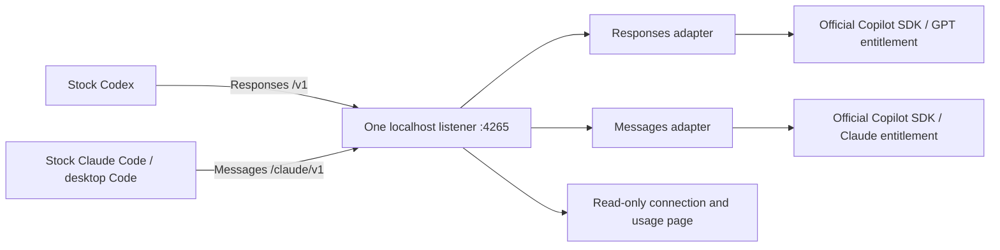

# One gateway for Codex and Claude Code

Source 1.3.65, Claude adapter 0.1.15. **Opt-in combined preview**, not an automatic
migration of an existing installation. No client binaries, saved authentication,
TOML, Remote pairing or existing gateways are modified by this launcher.

## Start

Use Node.js 22 or later and the repository's locked dependencies. In a fresh,
inactive checkout run `npm ci`, then authenticate the official Copilot CLI with
`node node_modules/@github/copilot/npm-loader.js login`. Use your own entitled
account and respect your organization policies. See [portable prerequisites](PORTABLE-LAUNCH.md).

```sh
node launch.mjs gateway --open
```

Windows: run `Start-Copilot-Gateway.ps1`. It opens the same combined service and
connection page. Default port: 4265. Existing ports 4144, 4246, 4261 and 4263 are
reserved: the launcher never adopts or stops them. `--check` opens and closes
both adapters without sending an inference request. A busy port fails explicitly.

### If a closed/crashed terminal leaves ownership behind (Windows)

Use `quit` for normal shutdown. Abruptly closing a Windows terminal can leave
`gateway.owner.json` receipts even after its processes exit. The launcher now
reports this specifically instead of hiding it behind a generic launch error.

```powershell
.\Start-Copilot-Gateway.ps1 -RecoverStopped
```

This is explicit recovery, not automatic takeover. It samples the process and
listener state repeatedly, refuses live/reused owner PIDs, surviving children,
ambiguous gateway/SDK workers, changing receipts, and linked paths. Only after
those checks does it archive the two stopped ownership receipts under
`runtime/unified/<port>/ownership-recovery/`, then start normally. Request history,
usage, account settings and other gateways are not removed or changed. If it
refuses, inspect the stated condition; do not delete runtime folders or kill
unrelated processes. On other operating systems, safe manual inspection is still
required. Durable keys and automatic crash recovery are not implied.



One launcher owns one HTTP server, with independent SDK workers and session
ownership for the two protocol adapters. This is not a one-worker rewrite.
There is no automatic direct OpenAI or Anthropic inference fallback.

## Connect the clients

| Client | Base URL | Local credential |
| --- | --- | --- |
| Codex | `http://127.0.0.1:4265/v1` | Terminal command `codex-key` |
| Claude Gateway | `http://127.0.0.1:4265/claude` | Terminal command `key` |
| Browser observer | `http://127.0.0.1:4265/dashboard/setup` | None; metadata only |

These are distinct, randomly generated **local session keys**, not account
credentials. They are not saved to disk, printed automatically or sent to the
browser. Each fresh launch generates new keys; update the clients accordingly.
Do not paste them into chat, GitHub, or screenshots.

### Claude desktop Code GUI

Follow [the supported desktop form instructions](CLAUDE-DESKTOP.md). Set Gateway
base URL to the `/claude` URL above, credential kind **Static API key**, auth scheme
**Bearer**, and paste the key from the terminal into the app. Enable Code; leave
experimental MCP tool search disabled. Respect managed settings; do not override
administrative policies. Save your work before applying/restarting the app.

Model discovery is `/claude/v1/models`; it lists only the authenticated Copilot
Claude catalog. Select the exact entitled ID, for example `claude-opus-5-5` when
advertised. A listening service is not a successful GUI conversation. Verify a
small Code-tab prompt, then a tool workflow, against completed SDK receipts.
The combined base-path GUI attachment has **not yet been verified**.

### Codex CLI without changing saved TOML

In a separate PowerShell terminal, read the local key without putting it in shell
history and use per-process config overrides:

```powershell
$relayLocalKey = Read-Host 'Paste the local codex-key' -MaskInput
$env:CODEX_COPILOT_BRIDGE_KEY = $relayLocalKey
try {
  codex -c 'model_provider="copilot_combined"' `
    -c 'model_providers.copilot_combined={name="Copilot combined",base_url="http://127.0.0.1:4265/v1",wire_api="responses",env_key="CODEX_COPILOT_BRIDGE_KEY",requires_openai_auth=false,stream_idle_timeout_ms=1800000}' `
    -c 'model="gpt-6.1-sol"' -c 'model_reasoning_effort="xhigh"'
} finally {
  Remove-Item Env:CODEX_COPILOT_BRIDGE_KEY -ErrorAction SilentlyContinue
  $relayLocalKey = $null
}
```

The example needs PowerShell 7 for `-MaskInput`; it does not alter sandbox or
approval settings. Exact model/effort support comes from your SDK catalog.
Codex desktop requires an explicit custom-provider configuration migration;
do not replace its account/Remote settings with this CLI example. The existing
desktop relay and restoration shortcuts stay unchanged in this preview.

## What the 409 repair does

The previous adapter bound all request settings to the retained SDK session.
Even a changed `max_tokens` could produce “owner/model/system/catalog changed”.
Adapter 0.1.15 first verifies the same owner and model, unchanged history, exact
outstanding results, and unchanged pending-tool executable schemas. If only
other request settings changed, it validates the context and creates a fresh SDK
session using the complete transcript, including actual thinking/signatures and
already supplied results. It does **not** execute tools again or invent results.
The old session is released only after the replacement exists. Admission/startup
failure leaves pending state available for retry. No model substitution occurs.

Receipts mark `continuationMode: rebuilt` and record changed **field names**, not
private field values. A rebuild can cost more context tokens and may lose cache
efficiency. Wrong ownership, edited history, missing/duplicate results, changed
model, or a changed pending-tool schema still reject. The old live error logs do
not identify which field changed in the user's GUI request; that exact historical
cause remains unproven.

## Usage, history, shutdown and limits

- The terminal labels Codex versus Claude events. Token/AI-credit measurements
  come from SDK receipts. Credits are not dollars, an invoice or remaining balance.
  Slow-console output is bounded and reports suppressed lines; disk receipts stay.
- Current history is `runtime/unified/<port>/`, with Claude metadata under
  `claude/ledger.json`. The connection page reads only these ledgers. Old 4144 and
  4261 histories remain untouched and separate; they are not lost or double-counted.
- Finish both clients' tasks before `quit`, EOF or Ctrl+C. This closes only the
  owned combined service. Stopping does not undo a manually saved client profile.
  Return Claude to normal sign-in and end the process-scoped Codex CLI to revert.
- No unattended watchdog, durable key management, automatic GUI migration,
  full Claude feature parity, voice/Remote certification or 12-hour soak is claimed.
  Existing native image helpers remain a separate opt-in OpenAI path, not Copilot.
- Published APIs and passing tests do not guarantee provider endorsement,
  contract compliance for every organization, no billing or no account suspension.
  See [provider boundaries](CLAUDE-GATEWAY-POLICY.md).

## Evidence

On October 8 the combined listener completed a real concurrent GPT Responses
stream and one-token Claude readiness response, then a real Claude tool turn
and changed-token-limit continuation: four inference calls, no failures, actual
models `gpt-6.1-sol` and `claude-opus-5.5`. Reported usage: 0.1188 + 0.5572 =
**0.676 Copilot AI credits**. The tool was a synthetic Echo fixture, not file work
or GUI proof. `node probe-unified.mjs --live` repeats the bounded test and consumes
Copilot allowance; it is not part of the offline test suite.

The final 1.3.64 build repeated the same live test successfully, with both client
event streams visible in the terminal. Across both runs the saved ledgers contain
8 completed requests, 0 failures, and 1.352 reported AI credits. The final offline
suite passed 435 tests with one existing skip and zero failures. Basic-revert and
Remote-policy fixture tests passed. The combined page was visually inspected at
1440, 820 and 390 pixels wide with no page-level overflow or browser console errors.

Regression, ownership, credential isolation, lifecycle and telemetry tests are
maintained in `unified-gateway.test.mjs`, `claude-gateway.test.mjs` and
`local-usage-history.test.mjs`. Tests and final source versions are recorded in
the local release handoff; API proof must not be advertised as GUI/native parity.
